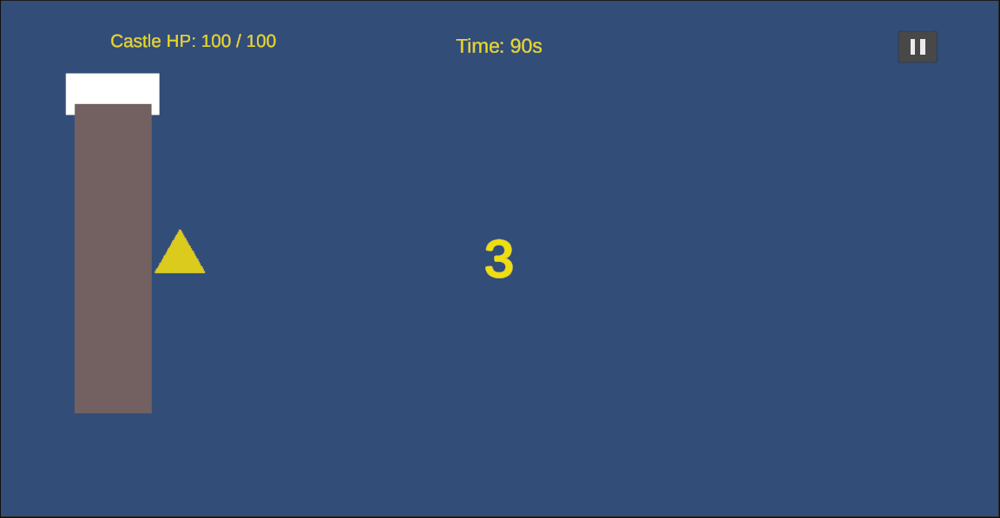
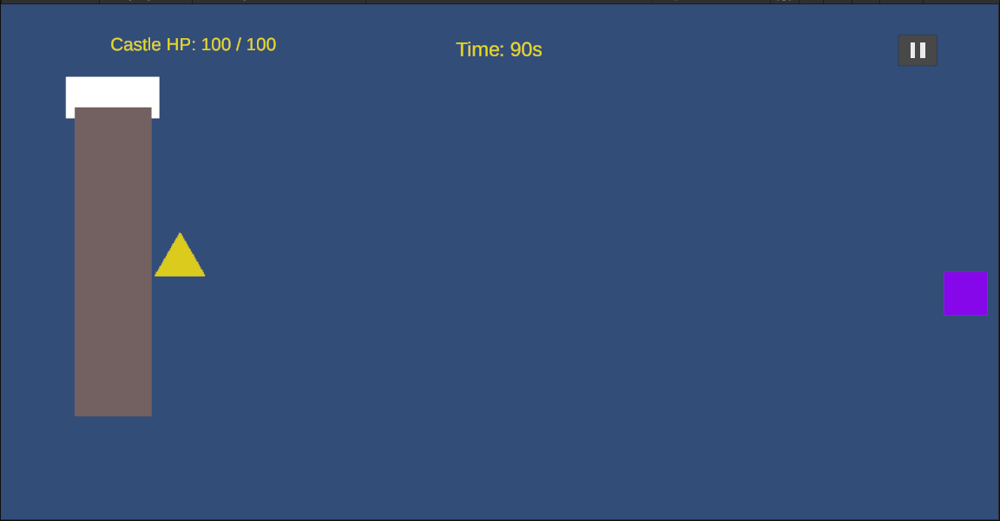
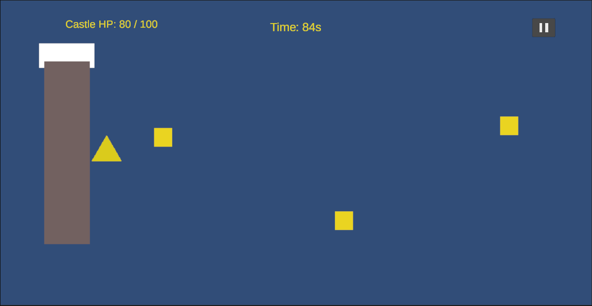
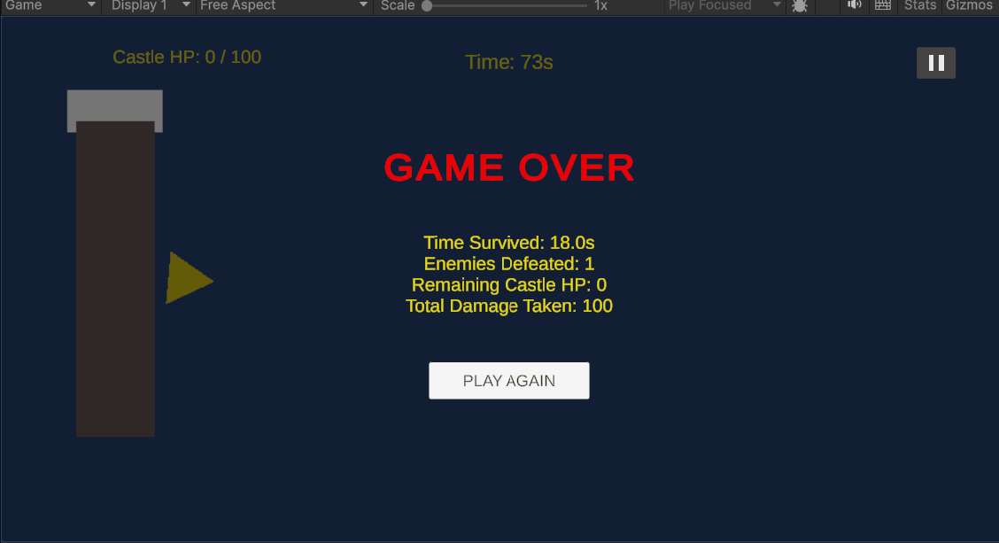
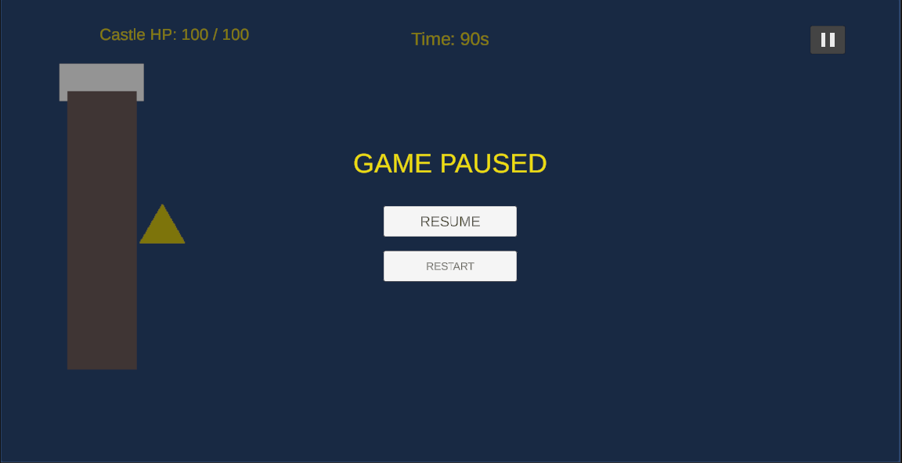

# Tower Defense Game

## 1. Student Information
- Name: Shahmeer Waqar Malik
- Roll Number: BCSF22M551

## 2. Game Description
Tower Defense is a strategy game in which
players defend their base from incoming enemies
by placing towers along the enemy path.

The objective is to stop enemies from reaching
the base and survive as many waves as possible.

## 3. Controls
- Mouse: Select and place towers.
- Mouse Click: Interact with game buttons.
- ESC: Pause the game.

## 4. Screenshots

## 5. Gameplay Recording
[Watch Gameplay Video](YOUR_VIDEO_LINK)

## 6. APK Download
[Download Android APK](YOUR_APK_LINK)

## 7. Implemented Features
- Tower placement
- Enemy spawning
- Enemy movement
- Health system
- Shooting system
- Game over system

## 8. Bonus Features
Add any extra features implemented in your game.
